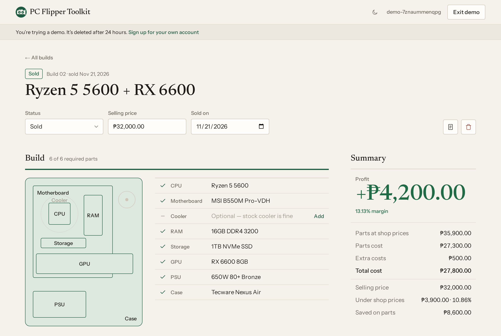
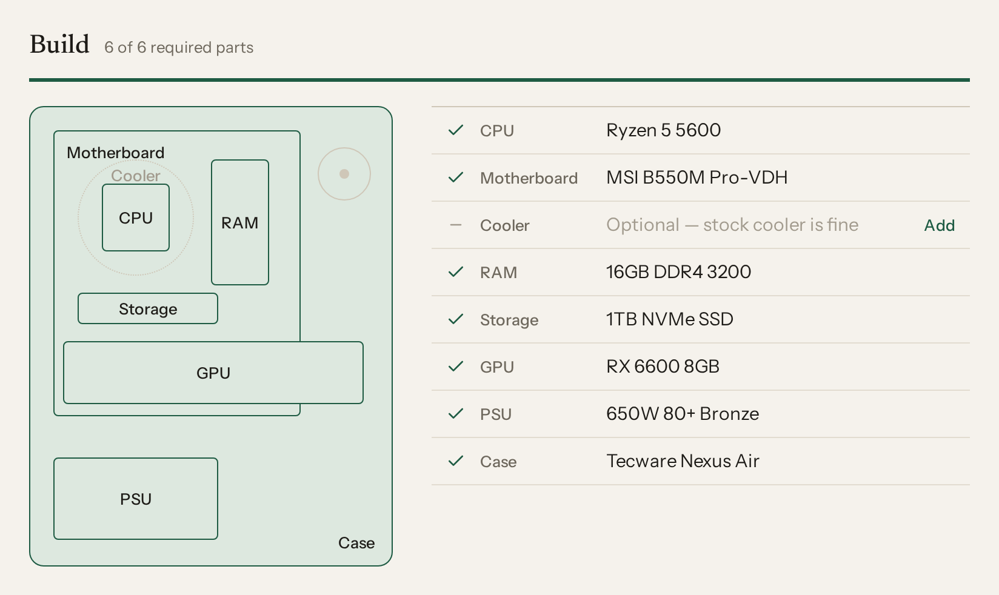
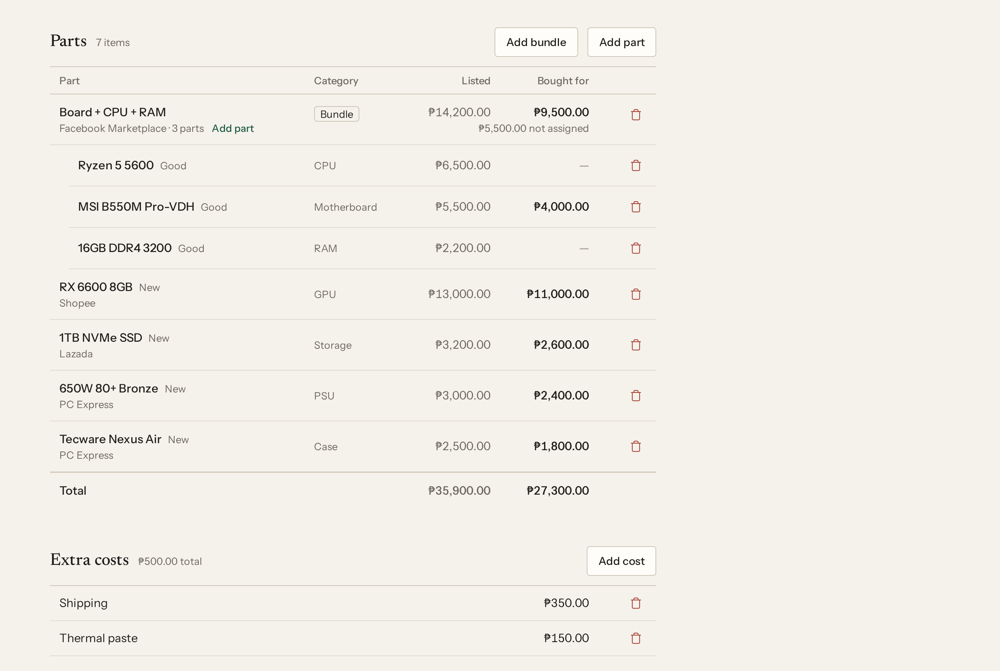
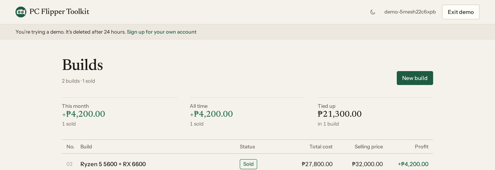
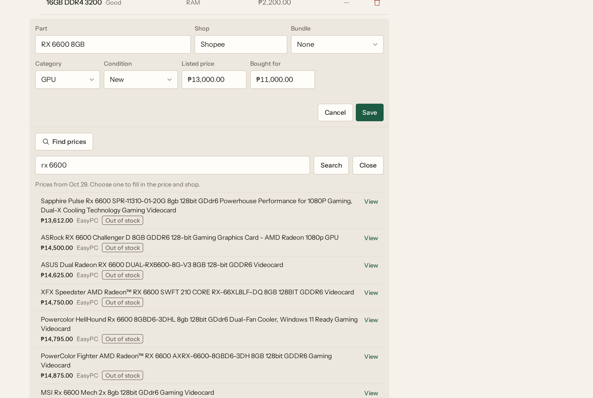
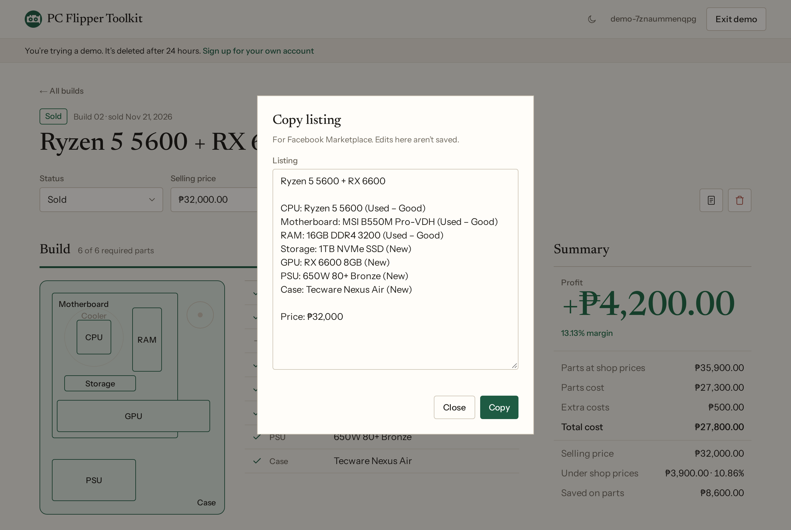
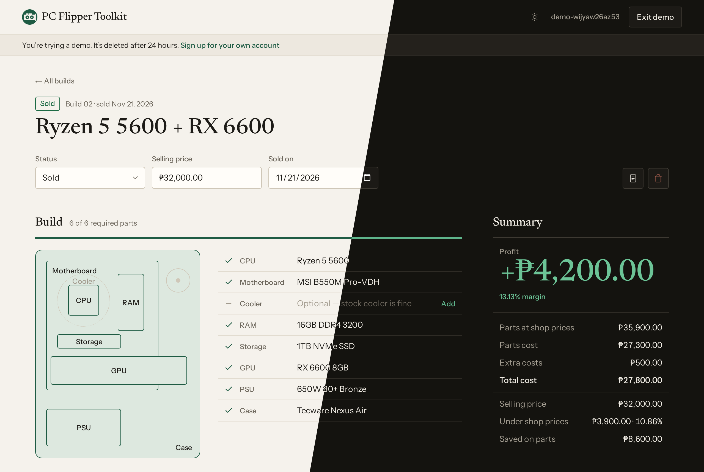

  <picture>
    <source media="(prefers-color-scheme: dark)" srcset="frontend/public/logo-dark.png">
    
  </picture>

<h1 align="center">PC Flipper Toolkit</h1>

  <strong>Track your profit on every PC you flip.</strong> 
  For people who flip PCs. Log each part, bundle and extra cost, and the app does the math.

  
  
  
  
  
  

  <a href="https://pc-flipper-toolkit.vercel.app"><strong>Open the app</strong></a> ·
  <a href="https://pc-flipper-toolkit.vercel.app"><strong>Try the demo</strong></a>, no sign-up needed ·
  <a href="https://pc-flipper-toolkit.onrender.com/api/docs/">API docs</a>

  
   
  A sold build: ₱4,200 profit on a Ryzen 5 5600 and RX 6600, from the demo.

  <a href="#features">Features</a> ·
  <a href="docs/getting-started.md">Getting started</a> ·
  <a href="docs/testing.md">Testing</a> ·
  <a href="docs/deployment.md">Deployment</a> ·
  <a href="#license">License</a>

> The API runs on Render's free tier, which sleeps after 15 minutes idle. The first visit
> after that takes up to a minute.

## Features

<table>
  <tr>
    <td width="50%" valign="top">
      
       The case fills in as you add parts.
      <h3>Every flip, part by part</h3>
      
Each build shows its parts, what's still missing, and the profit as it adds up, with the margin and what you saved.

    </td>
    <td width="50%" valign="top">
      
       Shop price and what you paid, part by part.
      <h3>What it tracks</h3>
      
Parts with their shop price and what you paid; a bundle counts once. Extra costs like shipping, platform fees and thermal paste.

    </td>
  </tr>
  <tr>
    <td width="50%" valign="top">
      
       Every build at a glance.
      <h3>See where each PC is</h3>
      
Planning, building, listed or sold, with each build's cost, price and profit.

    </td>
    <td width="50%" valign="top">
      
       Prices from EasyPC and PC Express.
      <h3>Find prices</h3>
      
Search the shops' catalogues while you edit a part, and pick one to fill in its price and shop.

    </td>
  </tr>
  <tr>
    <td width="50%" valign="top">
      
       Ready for Facebook Marketplace.
      <h3>Copy the listing</h3>
      
The build as a Marketplace post, with each part, its condition and the price.

    </td>
    <td width="50%" valign="top">
      
       Follows your system, or pick one.
      <h3>Light and dark</h3>
      
Warm paper by day, ink by night, on desktop and phone.

    </td>
  </tr>
</table>

## Built with

React 19, TypeScript, Vite and Tailwind CSS on Vercel; Django 6 and Django REST Framework on
Render; PostgreSQL on Neon. Money is stored as `Decimal` and travels as strings, so totals are
exact to the centavo.

To run it yourself, see [Getting started](docs/getting-started.md), then
[Testing](docs/testing.md) and [Deployment](docs/deployment.md).

## License

[MIT](LICENSE)
