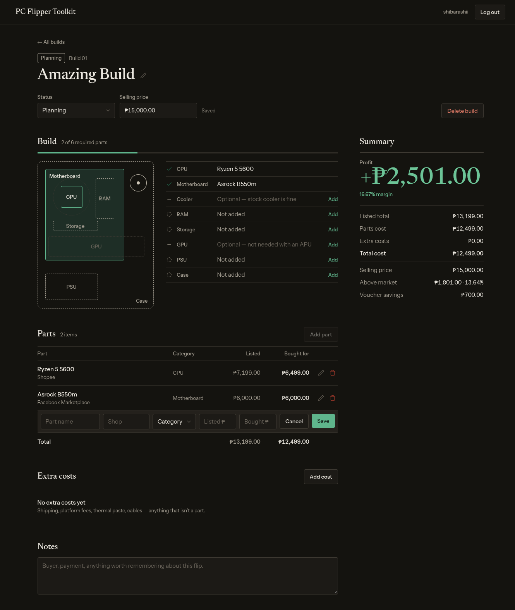
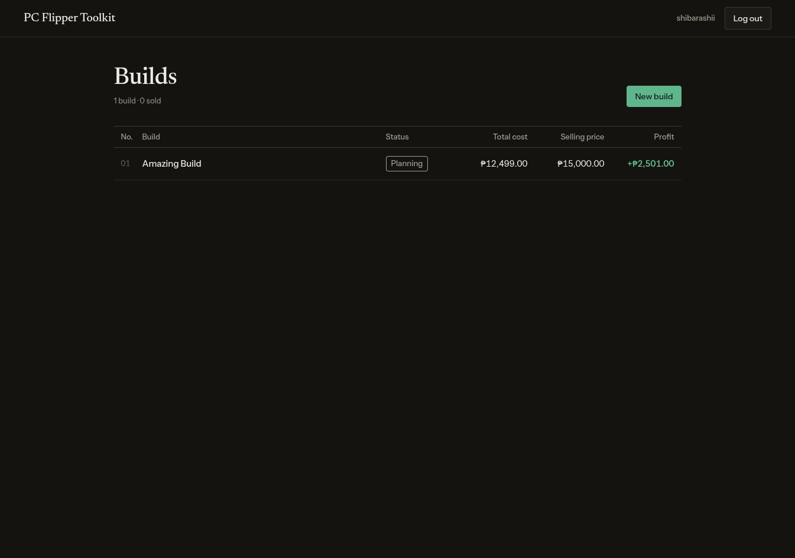

# PC Flipper Toolkit

[](https://github.com/Shibarashii/pc-flipper-toolkit/actions/workflows/ci.yml)

Track the profit on every PC you flip. Log each part with its market price and what you
actually paid, add the extras (shipping, fees, thermal paste), set a selling price, and see
your true profit, margin, and how far below market you're selling. Built to replace a
spreadsheet, with an account per user.

**Live app:** https://pc-flipper-toolkit.vercel.app (no sign-up needed: press **Try the demo** for a throwaway account with two sample builds)
**API docs:** https://pc-flipper-toolkit.onrender.com/api/docs/





> The API runs on Render's free tier, which sleeps after 15 minutes idle. The first request
> after that takes up to a minute while it wakes up.

## Stack

| Layer | Choice |
|---|---|
| Frontend | React 19, TypeScript, Vite, Tailwind CSS v4, on Vercel |
| API | Django 6, Django REST Framework, token auth, drf-spectacular docs, on Render (gunicorn + WhiteNoise) |
| Database | PostgreSQL, on Neon |

Money is stored as `Decimal` and travels as strings, so totals are exact to the centavo.

## Run it locally

You need Python 3.14, Node 24 and a local PostgreSQL server.

```sh
git clone https://github.com/Shibarashii/pc-flipper-toolkit.git
cd pc-flipper-toolkit
createdb pc_flipper_toolkit
```

**API** (http://localhost:8000):

```sh
cd backend
python -m venv .venv
.venv/bin/pip install -r requirements.txt -r requirements-dev.txt
cp .env.example .env
.venv/bin/python manage.py migrate
.venv/bin/python manage.py runserver
```

**Frontend** (http://localhost:5173, in a second terminal; Vite forwards `/api` to the API):

```sh
cd frontend
npm ci
npm run dev
```

Open http://localhost:5173 and sign up.

## Tests

```sh
(cd backend && .venv/bin/python manage.py test && .venv/bin/ruff check . && .venv/bin/ruff format --check .)
(cd frontend && npm test && npm run lint && npm run build)
```

End-to-end: Playwright tests (`frontend/e2e/`) sign up and flip a PC (loose parts and a bundle, pricing, totals, checklist, delete), try the demo, and check the price lookup's keys, at desktop and phone width. It starts Django and Vite itself (or reuses ones already running) on your local database.

```sh
(cd frontend && npx playwright install chromium && npm run e2e)
```

Sign-up is limited to 10 a minute, so running it many times in a row locally gets "Too many attempts" for a minute.

## Deployment

- **Render** (root `backend`): build `pip install -r requirements.txt && python manage.py collectstatic --noinput && python manage.py migrate`, start `gunicorn config.wsgi`. Environment: `SECRET_KEY`, `ALLOWED_HOSTS`, `DATABASE_URL` (Neon), `CORS_ALLOWED_ORIGINS` (the Vercel URL), `NUM_PROXIES=3`.
- **Vercel** (root `frontend`): Vite preset, `VITE_API_URL` set to the Render URL. `vercel.json` sends every path to `index.html` so deep links work, and its CSP's `connect-src` names the Render URL: change it together with `VITE_API_URL`, or the browser blocks every API call.

Both redeploy on every push to `main`. See [`backend/.env.example`](backend/.env.example) for what each setting does.

**Shop prices** for "Find prices" come from a copy of EasyPC's and PC Express's public catalogues, which [`refresh-prices.yml`](.github/workflows/refresh-prices.yml) refreshes daily at 2am Philippine time ([spec](docs/specs/price-lookup.md)).
- **Setup:** it needs one repository secret, `DATABASE_URL` (Neon's connection string), under Settings → Secrets and variables → Actions.
- **Run it now:** `gh workflow run refresh-prices.yml`, or the "Run workflow" button in the Actions tab.
- **If prices go stale:** GitHub turns scheduled workflows off after 60 days without activity in the repo, and the lookup's "Prices from" date stops moving. Re-enable it in the Actions tab.
- **Locally:** `.venv/bin/python manage.py refresh_shop_prices` fills your own database. It takes about 90 s and downloads about 50 MB, so run it at most once a day.

## Known limits

- The log-in rate limit (10 a minute per IP) is counted in each server process's memory, and
  it finds the visitor's IP by counting proxies (`NUM_PROXIES`). That's right for one free
  Render instance; more servers would need a shared store like Redis.
- No email or password reset (out of scope for v1).
